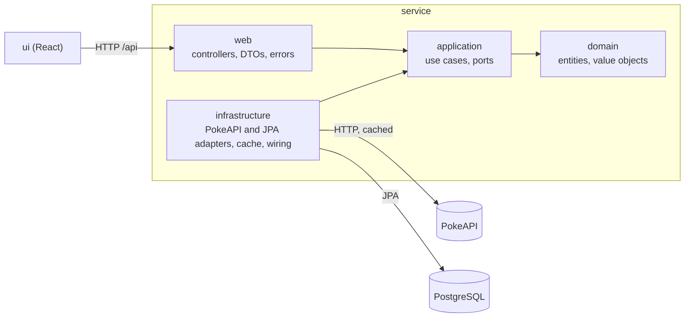

# Pokédex App

A full-stack Pokédex built for a Java technical interview: a Spring Boot REST API that browses
[PokeAPI](https://pokeapi.co/docs/v2), keeps a local collection of Pokémon with proprietary fields, and a React
front-end that consumes it.

The project is built story by story, test-first, on a Clean Architecture backend.

## User stories

| Story | What the user can do | Status |
| --- | --- | --- |
| US01 Browse | Page through Pokémon with sprite, category, weight and abilities | Done (API and UI) |
| US02 Details | See one Pokémon's artwork, base stats, description and evolution chain | Done (API and UI) |
| US03 Sync | Copy a Pokémon into the local database to add proprietary fields | Done (API and UI) |
| US04 Edit | Update the proprietary fields of a stored Pokémon, with validation; remove it | Done (API and UI) |
| Users | Register, log in, public versus protected routes | Planned |

## Quick start

Requirements: **JDK 25**, **Node.js 22.12+** and a **Docker** runtime (Docker Desktop or Rancher Desktop with the
dockerd engine). Gradle and its Java toolchain are handled by the Gradle wrapper.

Start PostgreSQL (port 5432):

```bash
docker compose up -d db
```

Start the API (port 8080). Flyway creates the schema on first start:

```bash
./service/gradlew -p service bootRun
```

In a second terminal, start the front-end:

```bash
npm --prefix ui install
npm --prefix ui run dev
```

Open the URL Vite prints (http://localhost:5173 by default). The dev server forwards `/api` calls to the API.

| What | Where |
| --- | --- |
| Front-end | http://localhost:5173 |
| API docs (Swagger UI) | http://localhost:8080/swagger-ui/index.html |
| OpenAPI document | http://localhost:8080/v3/api-docs |
| Health check | http://localhost:8080/actuator/health |

## Repository layout

```
pokedex-app/
├── docker-compose.yml   PostgreSQL for local development
├── service/             Spring Boot API (Java 25, Gradle)   → see service/README.md
└── ui/                  React front-end (TypeScript, Vite)  → see ui/README.md
```

## Architecture



- Every dependency points inward. The domain and the use cases are plain Java with no Spring, HTTP or persistence
  imports; ArchUnit tests fail the build if that rule is broken.
- Use cases talk to the outside world through ports (interfaces they own). Infrastructure implements them; the PokeAPI
  adapter is one such implementation.
- The front-end only knows the API's JSON contract and RFC 9457 error format.

## Tech stack

| Area | Choice | Why |
| --- | --- | --- |
| Language | Java 25 (LTS) | Current LTS; virtual threads no longer pin on `synchronized` (JEP 491) |
| Framework | Spring Boot 4.1 | Boot 3.5 open-source support ended 2026-06-30; 4.1 is supported to 2027-07-31 |
| Build | Gradle 9 (Kotlin DSL, version catalog) | Typed build scripts, one place for versions, wrapper included |
| PokeAPI client | `@HttpExchange` interface on `RestClient` | Declarative, synchronous, no reactive stack needed |
| Concurrency | Virtual threads | Parallel PokeAPI calls per page; Tomcat also serves requests on virtual threads |
| Cache | Caffeine via Spring Cache | Near-static data, single instance, no extra infrastructure |
| Database | PostgreSQL 17, Flyway, Spring Data JPA | Relational store for the collection; versioned schema migrations |
| Errors | RFC 9457 `ProblemDetail` | One standard error shape for every endpoint |
| API docs | springdoc-openapi | Swagger UI for every endpoint |
| Back-end tests | JUnit 5, AssertJ, Mockito, WireMock, Testcontainers, ArchUnit, JaCoCo | Unit, HTTP-contract, real-database, architecture and coverage |
| Front-end | React 19, TypeScript, Vite 8, Tailwind 4 | Typed components, fast dev server, responsive utility CSS |
| Server state | TanStack Query | Caching, loading and error states, pagination |
| Routing | React Router | One address per page; the catalog page lives in the address |
| Forms | React Hook Form + Zod | Client-side validation mirroring the API's rules |
| Front-end tests | Vitest, Testing Library, MSW | Tests that use the UI as a user would, against a fake API |

## Testing

```bash
./service/gradlew -p service build
npm --prefix ui test
```

The back-end tests start a throwaway PostgreSQL container with Testcontainers, so Docker must be running. The build
runs all tests and writes a JaCoCo coverage report to
`service/build/reports/jacoco/test/html/index.html`.

## How this project is built

The work follows one user story at a time, each split into small steps that are written test-first (a failing test,
then the code that makes it pass) and reviewed before the next. Decisions and their trade-offs are recorded as the
work goes; a write-up of the process, including how AI-generated code was checked and corrected, will be added
before submission.

## Roadmap

- User registration, login and protected routes (JWT)
- Seed data (Generations 1 and 2) and demo credentials
- Dockerfiles and Docker Compose
- GenAI exercise: a task-management API generated with an AI tool, with a review of its output
