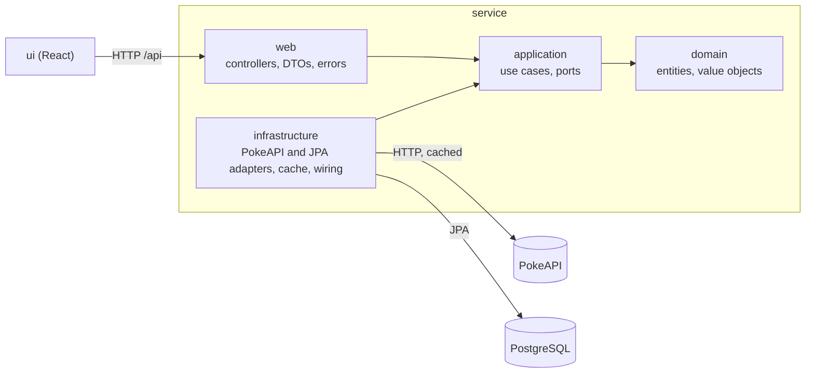

# Pokédex App

A full-stack Pokédex: a Spring Boot REST API that browses [PokeAPI](https://pokeapi.co/docs/v2), keeps a local
collection of Pokémon with proprietary fields, and a React front-end that consumes it.

The project is built story by story, test-first, on a Clean Architecture backend.

## User stories

| Story | What the user can do | Status |
| --- | --- | --- |
| US01 Browse | Page through Pokémon with sprite, category, weight and abilities | Done (API and UI) |
| US02 Details | See one Pokémon's artwork, base stats, description and evolution chain | Done (API and UI) |
| US03 Sync | Copy a Pokémon into the local database to add proprietary fields | Done (API and UI) |
| US04 Edit | Update the proprietary fields of a stored Pokémon, with validation; remove it | Done (API and UI) |
| Users | Register, log in, public versus protected routes | Done (API and UI) |

## Where each requirement is

| Requirement | Where |
| --- | --- |
| REST API integrating PokeAPI | `service`, see [PokeAPI integration](service/README.md#pokeapi-integration) |
| US01 browse, with caching | `GET /api/v1/catalog/pokemon`; Caffeine cache per PokeAPI resource |
| US02 details and evolution chain | `GET /api/v1/catalog/pokemon/{idOrName}` |
| US03 sync to a local database, with proprietary fields | `POST /api/v1/pokemon/sync`; nickname, notes, region, localized names, tags |
| US04 update with 404, 400 and more defensive logic | `PUT /api/v1/pokemon/{id}`: optimistic locking (409), strict JSON, field-level errors, see [Errors](service/README.md#errors) |
| Full CRUD, standard verbs, consistent responses | Create = sync, read = `GET`, update = `PUT`, delete = `DELETE` (ADMIN); every error is RFC 9457 |
| Relational database with a primary entity and users | PostgreSQL with Flyway, see [Database](service/README.md#database) |
| Register, log in, public versus protected routes | [Access](service/README.md#access) |
| Business logic independent of API and data access | [Architecture](#architecture), enforced by ArchUnit |
| Tests, TDD | [Testing](#testing) |
| Responsive React front-end with CRUD and clean state | [ui/README.md](ui/README.md) |
| README, demo data and credentials, Dockerfile | This file, [demo accounts](#run-from-source), `service/Dockerfile`, `ui/Dockerfile` |
| GenAI exercise | [genai/README.md](genai/README.md) |

## Quick start with Docker

Only a **Docker** runtime is needed (Docker Desktop, or Rancher Desktop with the dockerd engine):

```bash
docker compose up --build
```

The first build takes a few minutes. Then open http://localhost:3000 and log in with a demo account (below).

| Container | What | Port |
| --- | --- | --- |
| `ui` | nginx serving the React build; forwards `/api` to the service | 3000 |
| `service` | The Spring Boot API (Swagger UI at http://localhost:8080/swagger-ui/index.html) | 8080 |
| `db` | PostgreSQL 17, data kept in the `pokedex-db` volume | 5432 |

Ports can be changed with `UI_PORT`, `API_PORT` and `DB_PORT` (for example `UI_PORT=3001 docker compose up`).
`docker compose down` stops everything; add `-v` to also delete the database. The token secret has a demo default;
set `POKEDEX_SECURITY_JWT_SECRET` (32+ bytes) in the shell or a `.env` file for anything shared.

## Run from source

Requirements: **JDK 25**, **Node.js 22.12+** and a **Docker** runtime for PostgreSQL. Gradle and its Java toolchain
are handled by the Gradle wrapper.

Start PostgreSQL (port 5432):

```bash
docker compose up -d db
```

Start the API (port 8080). Flyway creates the schema on first start:

```bash
./service/gradlew -p service bootRun
```

In a second terminal, start the front-end:

```bash
npm --prefix ui install
npm --prefix ui run dev
```

Open the URL Vite prints (http://localhost:5173 by default). The dev server forwards `/api` calls to the API.

| What | Where |
| --- | --- |
| Front-end | http://localhost:5173 |
| API docs (Swagger UI) | http://localhost:8080/swagger-ui/index.html |
| OpenAPI document | http://localhost:8080/v3/api-docs |
| Health check | http://localhost:8080/actuator/health |

On first start the API fills the collection with every Pokémon of Generations 1 and 2 (from a PokeAPI snapshot bundled
with the service, so no network is needed) and creates two demo accounts:

| Username | Password | Role | Can |
| --- | --- | --- | --- |
| `oak` | `professor123` | ADMIN | Everything, including removing Pokémon from the collection |
| `ash` | `pikachu123` | USER | Add, edit and refresh Pokémon |

These passwords are public: turn seeding off (`POKEDEX_SEED_ENABLED=false`) anywhere but a local or demo setup.
Anyone can also create a `USER` account with "Sign up".

## Repository layout

```
pokedex-app/
├── docker-compose.yml   Whole stack (db, service, ui), or only the database for development
├── genai/               GenAI exercise: prompt, task API, validation → see genai/README.md
├── service/             Spring Boot API (Java 25, Gradle)   → see service/README.md
└── ui/                  React front-end (TypeScript, Vite)  → see ui/README.md
```

## Architecture



- Every dependency points inward. The domain and the use cases are plain Java with no Spring, HTTP or persistence
  imports; ArchUnit tests fail the build if that rule is broken.
- Use cases talk to the outside world through ports (interfaces they own). Infrastructure implements them; the PokeAPI
  adapter is one such implementation.
- The front-end only knows the API's JSON contract and RFC 9457 error format.

## Tech stack

| Area | Choice | Why |
| --- | --- | --- |
| Language | Java 25 (LTS) | Current LTS; virtual threads no longer pin on `synchronized` (JEP 491) |
| Framework | Spring Boot 4.1 | Boot 3.5 open-source support ended 2026-06-30; 4.1 is supported to 2027-07-31 |
| Build | Gradle 9 (Kotlin DSL, version catalog) | Typed build scripts, one place for versions, wrapper included |
| PokeAPI client | `@HttpExchange` interface on `RestClient` | Declarative, synchronous, no reactive stack needed |
| Concurrency | Virtual threads | Parallel PokeAPI calls per page; Tomcat also serves requests on virtual threads |
| Cache | Caffeine via Spring Cache | Near-static data, single instance, no extra infrastructure |
| Database | PostgreSQL 17, Flyway, Spring Data JPA | Relational store for the collection; versioned schema migrations |
| Security | Spring Security, OAuth2 resource server, HS256 JWT, BCrypt | Stateless Bearer tokens checked by the framework, no hand-written token parsing |
| Errors | RFC 9457 `ProblemDetail` | One standard error shape for every endpoint |
| API docs | springdoc-openapi | Swagger UI for every endpoint |
| Back-end tests | JUnit 5, AssertJ, Mockito, WireMock, Testcontainers, ArchUnit, JaCoCo | Unit, HTTP-contract, real-database, architecture and coverage |
| Front-end | React 19, TypeScript, Vite 8, Tailwind 4 | Typed components, fast dev server, responsive utility CSS |
| Server state | TanStack Query | Caching, loading and error states, pagination |
| Routing | React Router | One address per page; the catalog page lives in the address |
| Forms | React Hook Form + Zod | Client-side validation mirroring the API's rules |
| Front-end tests | Vitest, Testing Library, MSW | Tests that use the UI as a user would, against a fake API |

## Testing

```bash
./service/gradlew -p service build
npm --prefix ui test
```

The back-end tests start a throwaway PostgreSQL container with Testcontainers, so Docker must be running. The build
runs all tests and writes a JaCoCo coverage report to
`service/build/reports/jacoco/test/html/index.html`.

| Part | Tests | Notes |
| --- | --- | --- |
| Service | 318 | 96% of lines covered; 97 to 100% in `domain` and `application` |
| UI | 104 | Every screen tested as a user would use it, against a fake API |
